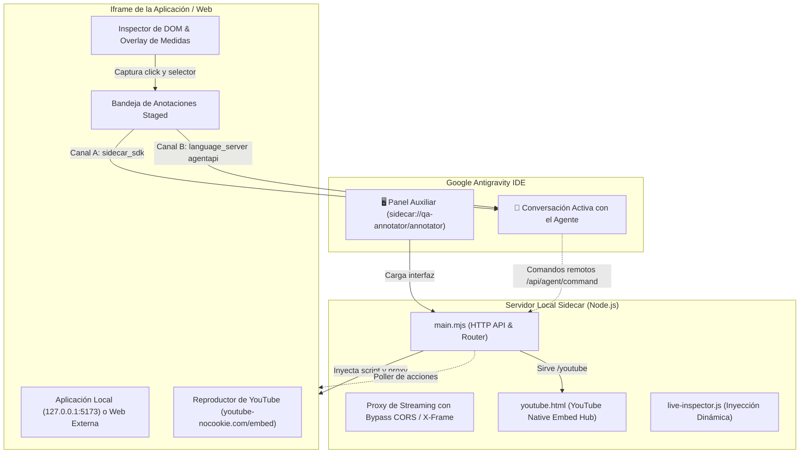

# 🌐 Antigravity Browser & QA Annotator 2.0 (OpenCode Style)

[](LICENSE)
[](https://antigravity.google)
[](plugin.json)
[](https://github.com/brayancortes22)

> **Navegador Web Integrado & QA Inspector Visual en Vivo** para el panel auxiliar lateral de Google Antigravity. Diseñado para replicar e integrar la experiencia de inspección milimétrica de elementos estilo **OpenCode**, permitiendo anotar componentes, buscar en Google, reproducir YouTube nativamente, navegar sitios locales o externos y entregar comentarios técnicos directamente a tu agente de IA en tiempo real.

---

## 🚀 Características Principales

### 1. 🔍 Omnibox Inteligente y Navegación Multi-Pestaña
- **Buscador Google Integrado:** Escribe cualquier consulta (ej. `como centrar div tailwind`, `react 19 hooks`) y busca directamente usando el motor oficial de Google (`igu=1`) sin salir de la interfaz.
- **Bypass de Restricciones X-Frame-Options:** Navega por sitios web públicos externos (Wikipedia, SENA, GitHub, Tailwind Docs) gracias al proxy interno de streaming que elimina cabeceras restrictivas e inyecta dinámicamente el inspector.
- **Acceso Inmediato a Servidores Locales:** Detección automática y accesos rápidos a `http://127.0.0.1:5173`, `localhost:3000`, `localhost:8000`.
- **Pestañas Persistentes:** Abre múltiples pestañas independientes (`+`), ciérralas individualmente (`✕`), con controles completos de navegación (Atrás, Adelante, Recargar, Zoom de 75% a 110%).
- **Confinamiento Estricto de Enlaces:** Bloqueo de `window.open` y enlaces con `target="_blank"`; cualquier clic en un resultado o hipervínculo se mantiene estrictamente dentro de la pestaña activa sin abrir ventanas externas del sistema operativo.

### 2. 🎬 YouTube Hub & Reproductor de Video Nativo (Cero Bloqueos)
- **YouTube Embed Engine:** Soporte nativo para videos de YouTube mediante la arquitectura oficial `youtube-nocookie.com/embed` con aceleración de hardware para streaming (`autoplay`, `encrypted-media`, `picture-in-picture`, `fullscreen`).
- **Conversión Inteligente de Enlaces:** Pega cualquier enlace de YouTube (`https://www.youtube.com/watch?v=...`, `https://youtu.be/...` o `shorts/...`) en el Omnibox o haz clic en cualquier resultado de búsqueda; el navegador lo transformará automáticamente al reproductor embebido de alta fidelidad sin bloqueos de CORS.
- **Atajo `▶️ YouTube` y Hub Integrado:** Al hacer clic en el botón `▶️ YouTube` o escribir `youtube` en el omnibox, se abre el **YouTube Hub** integrado para buscar videos, explorar tutoriales o escuchar música de programación (*Lofi Girl Coding*, *Synthwave Radio*).

### 3. 🎯 Inspector Visual Milimétrico en Vivo (OpenCode Style)
- **Modo Hover Fluido:** Dibuja un marco de selección cian sobre cualquier elemento del DOM, desplegando un badge flotante oscuro con:
  - Selector CSS exacto y legible (`#root > main > div...`).
  - Clases completas (Tailwind o CSS estándar).
  - Dimensiones calculadas al píxel (`1280 × 422 px`) y coordenadas `(X, Y)`.
  - Padding computado y accesibilidad (Role y keyboard focusable).
- **Congelamiento de Selección:** Al hacer clic sobre cualquier elemento, la selección se congela con un borde verde esmeralda y se abre la tarjeta flotante con el selector y el campo de instrucción técnica (*"Add an optional comment..."*).
- **Envío Inmediato con `✓` o `Enter`:** Despacha la instrucción directamente a la conversación activa con el agente.

### 4. 🏷️ Staged Annotations Dock (Bandeja Inferior OpenCode)
- **Chips Flotantes de Anotaciones:** Cada elemento inspeccionado se apila en una barra inferior compacta con el selector CSS y el comentario del usuario.
- **Gestión Individual y Masiva:**
  - Botón `✕` en cada tarjeta para descartar anotaciones individuales.
  - Botón `✕ Limpiar todas` para vaciar la bandeja en un clic.
- **Auto-Copia al Portapapeles:** Copia automáticamente el texto formateado al portapapeles para pegarlo instantáneamente con `Ctrl + V` en cualquier momento.

### 5. 🤖 Control Remoto Bidireccional Agente ⇄ Navegador
- El agente de IA puede enviar acciones estructuradas de forma autónoma:
  - `navigate`: Carga URLs automáticamente mientras el usuario observa.
  - `click`: Hace clic en selectores específicos con destellos visuales.
  - `fill`: Escribe datos en formularios en tiempo real.
  - `snapshot`: Analiza la estructura del DOM en vivo.
- Notificaciones Toast en pantalla (*"🤖 Agente ejecutando..."*) para que siempre tengas trazabilidad visual de lo que el modelo está realizando.

---

## 🏛️ Arquitectura del Sistema



---

## 📦 Instalación

### Método 1: Instalación Rápida en Windows (PowerShell)

Clona este repositorio o copia sus archivos dentro de tu máquina y ejecuta el instalador automatizado:

```powershell
# 1. Clona el repositorio
git clone https://github.com/brayancortes22/antigravity-browser-annotator.git
cd antigravity-browser-annotator

# 2. Ejecuta el script de instalación (cierra Antigravity previamente)
.\install.ps1
```

El script se encargará de:
1. Copiar los archivos a `%USERPROFILE%\.gemini\config\plugins\qa-annotator`.
2. Registrar el plugin y activar el sidecar en `%USERPROFILE%\.gemini\config\config.json`.
3. Crear un punto de respaldo de tu configuración actual.

---

### Método 2: Instalación Manual

1. Copia la carpeta del plugin a:
   ```
   C:\Users\<TU_USUARIO>\.gemini\config\plugins\qa-annotator
   ```
2. Abre `C:\Users\<TU_USUARIO>\.gemini\config\config.json` y agrega en la clave `"sidecars"`:
   ```json
   "sidecars": {
     "qa-annotator/annotator": {
       "enabled": true,
       "schemaVersion": 1
     }
   }
   ```
3. Reinicia Google Antigravity.

---

## 🕹️ Cómo Utilizarlo

1. **Abrir el Panel:**
   - Haz clic en cualquier enlace interno: `sidecar://qa-annotator/annotator`
   - O abre el icono **Navegador Web & QA Annotator** en la barra lateral derecha de Antigravity.
2. **Reproducir YouTube:**
   - Haz clic en el botón `▶️ YouTube` en la barra de atajos o escribe `youtube` en el omnibox.
   - O pega cualquier enlace directo (`https://www.youtube.com/watch?v=...`) para reproducirlo al instante.
3. **Inspeccionar:**
   - Pulsa el botón `🎯 Inspector` en la barra superior.
   - Pasa el cursor sobre cualquier componente para ver su caja milimétrica.
   - Haz clic para congelar y escribe la instrucción que deseas que el agente aplique.
   - Presiona `✓` o `Enter` para enviar la anotación al chat.

---

## 📄 Licencia

Este proyecto está distribuido bajo la licencia [MIT](LICENSE).

Desarrollado con dedicación por **Brayan Stid Cortés Lombana (`bscl`)**.
