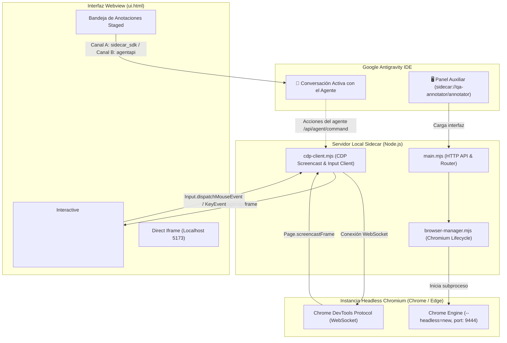

# 🌐 Antigravity Browser & QA Annotator 3.0 (Native CDP Screencast & OpenCode Inspector)

[](LICENSE)
[](https://antigravity.google)
[](plugin.json)
[](https://github.com/brayancortes22)

> **Navegador Web Integrado con Motor Dual (Local Iframe + Chromium CDP Screencast)** para el panel auxiliar lateral de Google Antigravity. Diseñado para replicar e integrar la experiencia de navegación e inspección milimétrica de elementos estilo **OpenCode**, permitiendo co-navegar sitios web sin restricciones (incluyendo YouTube escritorio completo, Yanbal, SENA, Google), interactuar simultáneamente usuario y agente con ratón y teclado, y entregar anotaciones técnicas directamente al chat de Antigravity en tiempo real.

---

## 🚀 Características Principales

### 1. 🚀 Motor Dual de Renderizado (Dual Engine)
- **Motor A (Direct Iframe):** Optimizado para desarrollo local ultra-rápido con latencia cero (`http://127.0.0.1:5173`, `localhost:3000`, `localhost:8000`).
- **Motor B (Chromium CDP Screencast Engine):** Instancia de navegador nativo en segundo plano impulsada por Chrome DevTools Protocol (`Page.startScreencast`, `Input.dispatchMouseEvent`, `Input.dispatchKeyEvent`).
  - **Cero restricciones:** Bypassea completamente las limitaciones de `X-Frame-Options`, directivas CSP, frame-busting y partición de cookies.
  - **YouTube Escritorio Completo:** Búsqueda en vivo, miniaturas dinámicas, reproducción de video en streaming con aceleración y controles interactivos sin requerir iframes embebidos.
  - **Blindaje Anti-Bot Stealth:** Identificación como navegador de escritorio genuino (`--disable-blink-features=AutomationControlled` y neutralización de `navigator.webdriver`), permitiendo acceder a sitios con protección Akamai / Cloudflare (como Yanbal).

### 2. 👥 Co-Navegación e Interacción Bidireccional en Tiempo Real
- **Interacción Humana Fluida:** El usuario puede hacer clic, scroll con la rueda del ratón y escribir con el teclado directamente sobre el `<canvas>` interactivo; cada evento es escalado con precisión milimétrica al viewport de Chromium.
- **Acción Autónoma del Agente:** El agente de IA puede navegar, pulsar botones, rellenar formularios o evaluar JavaScript en la página; el usuario ve todas las acciones del agente reflejadas en vivo a 30-60 FPS en su pantalla.

### 3. 🎯 Inspector Visual Milimétrico en Vivo (OpenCode Style)
- **Inspección Profunda de Nodos:** Al activar `🎯 Inspector`, el movimiento del ratón sobre el canvas consulta las coordenadas nativas (`DOM.getNodeForLocation` / `document.elementFromPoint`), resaltando el elemento con:
  - Selector CSS exacto y legible (`ytd-video-renderer a#video-title`).
  - Clases completas (Tailwind o CSS estándar).
  - Dimensiones calculadas (`1262 × 704 px`) y coordenadas `(X, Y)`.
- **Congelamiento de Selección y Comentarios:** Al hacer clic, se congela el elemento y se permite redactar una instrucción técnica enviada directamente al chat del agente.

### 4. 🏷️ Staged Annotations Dock (Bandeja Inferior OpenCode)
- **Chips Flotantes de Anotaciones:** Cada elemento inspeccionado se apila en una barra inferior compacta con el selector CSS y el comentario del usuario.
- **Auto-Copia al Portapapeles:** Copia automáticamente el texto formateado al portapapeles para pegarlo con `Ctrl + V` en cualquier momento.

---

## 🏛️ Arquitectura del Sistema



---

## 📦 Instalación

### Método 1: Instalación Rápida en Windows (PowerShell)

Clona este repositorio y ejecuta el instalador automatizado:

```powershell
# 1. Clona el repositorio
git clone https://github.com/brayancortes22/antigravity-browser-annotator.git
cd antigravity-browser-annotator

# 2. Ejecuta el script de instalación (cierra Antigravity previamente)
.\install.ps1
```

---

## 📄 Licencia

Este proyecto está licenciado bajo la **Licencia MIT** - ver el archivo [LICENSE](LICENSE) para más detalles.
