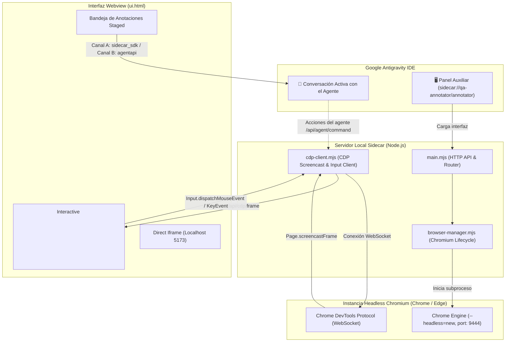

# 🌐 Antigravity Browser & QA Annotator 3.3

[](LICENSE)
[](https://antigravity.google)
[](plugin.json)
[](https://github.com/brayancortes22)

> Navegador integrado para el panel auxiliar de Antigravity con Chromium CDP, iframe para desarrollo local, enjambre multiagente autónomo en vivo (Swarm QA), inspección milimétrica de elementos, interacción con teclado, clic y scroll, y entrega infalible de comentarios y reportes de auditoría al chat activo.

---

## 🚀 Características Principales

### 1. 🚀 Motor Dual de Renderizado (Dual Engine)
- **Motor A (Direct Iframe):** Optimizado para desarrollo local ultra-rápido con latencia cero (`http://127.0.0.1:5173`, `localhost:3000`, `localhost:8000`).
- **Motor B (Chromium CDP Screencast Engine):** Instancia de Chromium aislada en segundo plano, controlada mediante Chrome DevTools Protocol.
  - Navega páginas externas aunque no permitan mostrarse en un iframe.
  - Adapta el viewport de Chromium al tamaño del panel para que las páginas hagan reflow.
  - Recibe cuadros nuevos a medida que Chromium los produce y transmite clic, teclado y rueda del ratón.
  - Respeta los controles de acceso, autenticación y protección del sitio visitado.

### 2. 👥 Co-Navegación e Interacción Bidireccional en Tiempo Real
- **Interacción Humana:** El usuario puede hacer clic, desplazarse con la rueda y escribir directamente sobre el canvas; las coordenadas se ajustan al viewport activo de Chromium.
- **Acción Autónoma del Agente:** El agente de IA puede navegar, pulsar botones, rellenar formularios o evaluar JavaScript en la página; el usuario ve todas las acciones del agente reflejadas en vivo a 30-60 FPS en su pantalla.

Los sitios públicos que bloquean iframes permanecen en Chromium. El cambio manual a
iframe se limita a páginas locales para evitar una pantalla vacía o reiniciar un
formulario y perder su scroll cuando el servidor no permite embeberse.

### 3. 🎯 Inspector Visual Milimétrico en Vivo (OpenCode Style)
- **Inspección Profunda de Nodos:** Al activar `🎯 Inspector`, el movimiento del ratón sobre el canvas consulta las coordenadas nativas (`DOM.getNodeForLocation` / `document.elementFromPoint`), resaltando el elemento con:
  - Selector CSS exacto y legible (`ytd-video-renderer a#video-title`).
  - Clases completas (Tailwind o CSS estándar).
  - Dimensiones calculadas (`1262 × 704 px`) y coordenadas `(X, Y)`.
- **Congelamiento de Selección y Comentarios:** Al hacer clic, se congela el elemento y se permite redactar una instrucción técnica enviada directamente al chat del agente.

### 4. 🏷️ Staged Annotations Dock (Bandeja Inferior OpenCode Colapsable)
- **Chips Flotantes de Anotaciones:** Cada elemento inspeccionado se apila en una barra inferior compacta con el selector CSS y el comentario del usuario.
- **Modo Colapsable / No Obstructivo:** Botón toggle con contador dinámico (`💬 N comentarios ▼ / ▲`) y altura máxima con scroll sutil (`max-height: 125px`) para no cubrir ni bloquear la página web cuando se acumulan múltiples comentarios.
- **Entrega Infalible al Chat:** Doble canal de entrega (Channel A con `window.sidecar.agent` y Channel B autenticado vía API con fallback a `agentapi send-message`), resolviendo automáticamente el `conversationId` activo de la sesión.
- **Auto-Copia al Portapapeles:** Copia automáticamente el texto formateado al portapapeles para pegarlo con `Ctrl + V` en cualquier momento.

### 5. 👥 Enjambre Multiagente Autónomo en Vivo (Swarm QA Engine)
- **4 Subagentes Especializados en Pantalla:** Despliega concurrentemente a `Layout Inspector` (#38BDF8), `Forms & A11y` (#34D399), `Responsive QA` (#A78BFA) e `Interactive QA` (#F472B6).
- **Cinemática Fluida y Cero Hardcoding:** Vuelo con transiciones `cubic-bezier`, ondas de clic (`swarm-cursor-ripple`) y cajas elásticas delimitadoras que abrazan dinámicamente los elementos mediante selectores reales del DOM (`getBoundingClientRect()`).
- **Candado de Mutación Seguro:** Gestión de exclusión mutua (`LockManager`) que previene condiciones de carrera en clics, scroll y cambios de ruta.
- **Barra de Estado HUD en Vivo:** Barra inferior con contadores reactivos (`role="status"`, `aria-live="polite"`), compatible con directrices WCAG 2.2 y Vercel Web Interface Guidelines.

---

## 🏛️ Arquitectura del Sistema



---

## 📦 Instalación

### Método 1: Instalación Rápida en Windows (PowerShell)

Clona este repositorio y ejecuta el instalador automatizado:

```powershell
# 1. Clona el repositorio
git clone https://github.com/brayancortes22/antigravity-browser-annotator.git
cd antigravity-browser-annotator

# 2. Ejecuta el script de instalación (cierra Antigravity previamente)
.\install.ps1
```

---

## 📄 Licencia

Este proyecto está licenciado bajo la **Licencia MIT** - ver el archivo [LICENSE](LICENSE) para más detalles.
